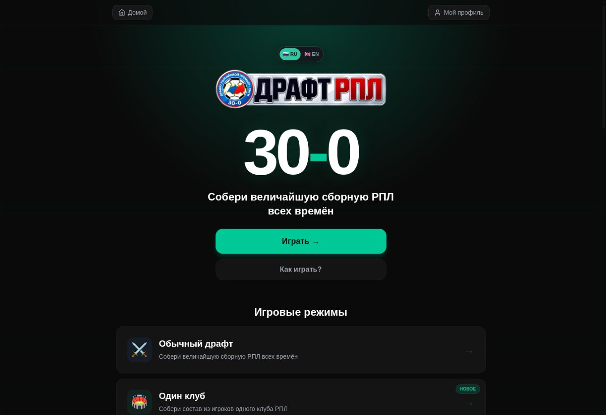
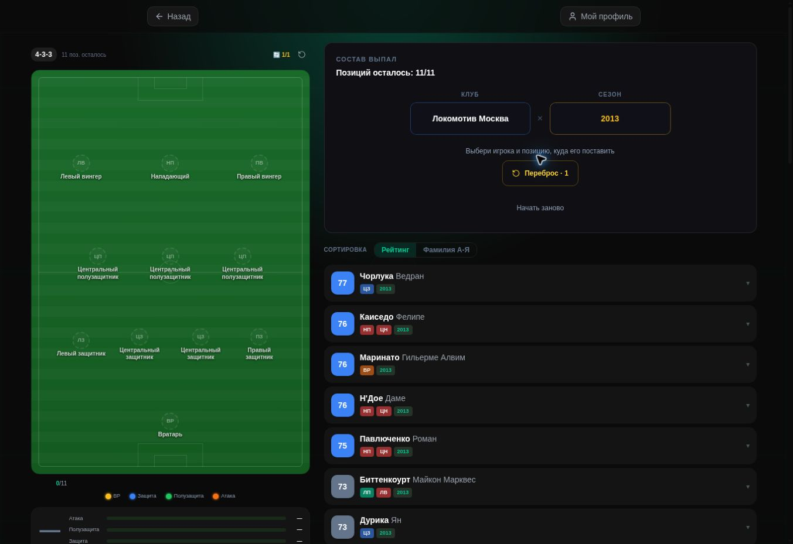
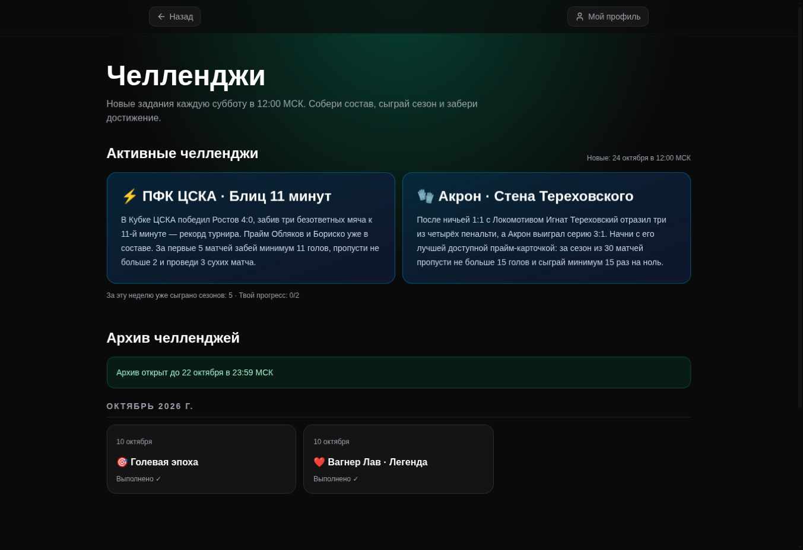

# Build your XI. Play your season.

A Telegram football draft game featuring Russian Premier League players across different seasons.

**[Play in Telegram](https://t.me/RPL30_bot?startapp)** · [Русский](README.md) · [Documentation](docs/README.md)

## The game

Choose a formation, spin for a club and season, pick eligible players and complete an eleven-player squad. Simulate 30 matches and review the league table, goalscorers and assist leaders.

| Mode | Experience |
|---|---|
| Classic draft | Build a squad across different clubs and seasons. |
| One club | Combine different generations of the same club. Normal and prime cards and historical opponents are implemented in the code. |
| Challenges | Play objectives, earn achievements and unlock archived challenges. |
| Multiplayer | Draft in a room, compete with friends and inspect participants’ squads after the season. This mode is still evolving. |

Profiles include season history, friends, achievements and a favourite club. The UI supports Russian and English. Player and club names use shared localisation helpers and editable overrides. Starting a game requires Telegram authentication.

## Screenshots

| Draft | Challenges |
|---|---|
|  |  |

These are actual desktop screenshots captured on 22 October 2026. [Capture notes](docs/media/README.md).

## Data and stack

Production snapshot, **22 October 2026, 13:07 UTC**: **39 clubs, 3,462 players, 9,642 seasonal cards and 20 seasons (2006–2025)**. The 2026 season is configured as a target but has no verified imported source yet. Ratings are game parameters, not football predictions.

Next.js 16, React 19, TypeScript, Tailwind CSS 4, Zustand and Prisma 6. Production runs on Jino with Passenger and MySQL. SQLite is used locally. Notifications use a durable outbox, Telegram Serverless and a queue relay.

[Development](DEVELOPMENT.md) · [Architecture](ARCHITECTURE.md) · [Deployment](DEPLOYMENT.md) · [Data quality](docs/DATA_QUALITY.md)

## Verification and open work

Audit of commit `9c217ba`: 147 tests, all isolated integration scenarios, type checking and a production build passed. ESLint reports three navigation warnings. Production dependencies have no known vulnerabilities in the audit snapshot; a high-severity advisory affects a development dependency chain. The latest deployment failed during SSH upload, so current main is not confirmed installed. [Full audit and limitations](docs/audits/2026-10-22.md).

This is a fan-made game. No source-code redistribution licence has been declared. Club names and marks belong to their respective owners.
