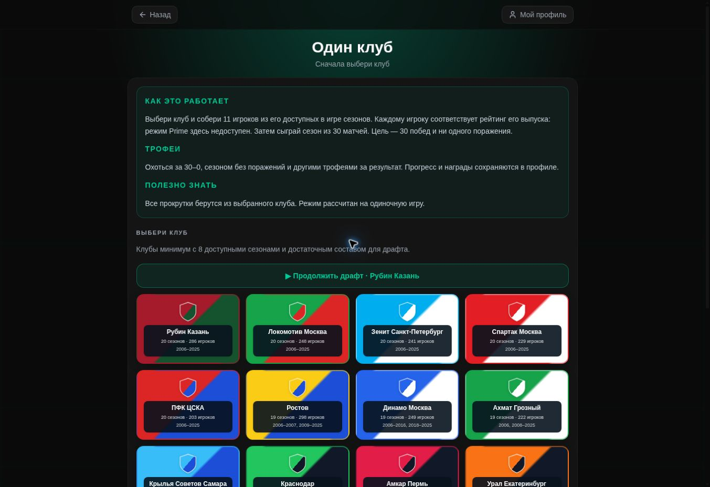
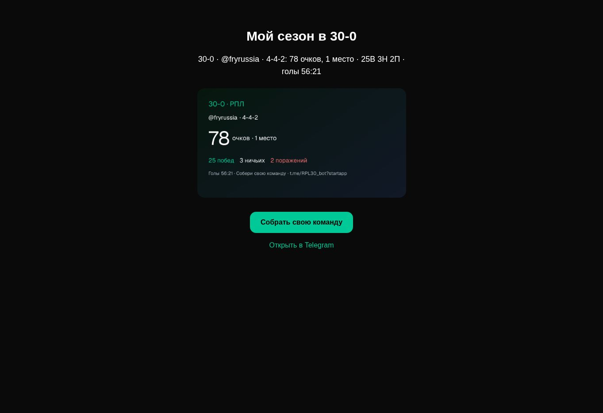
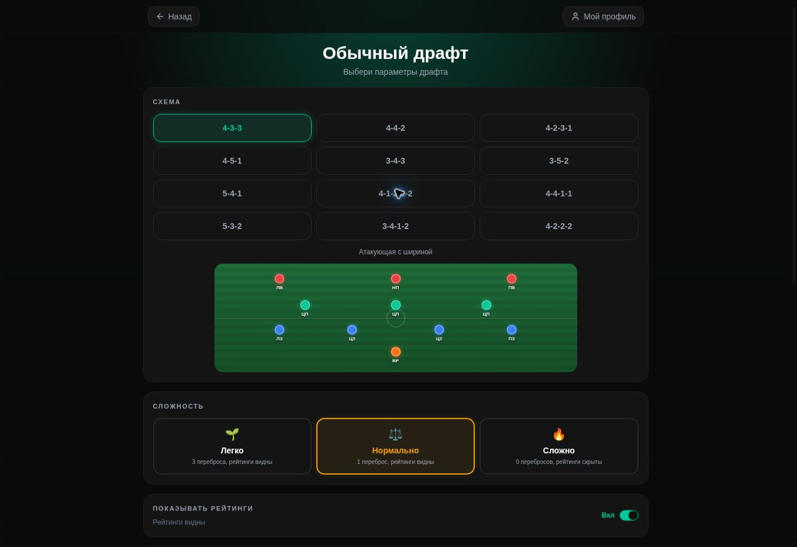

<div align="center">
  <a href="https://t.me/RPL30_bot?startapp"></a>

# Собери величайшую сборную РПЛ всех времён.

Футбольный драфт в Telegram: игроки РПЛ разных лет, 30 матчей, челленджи и соперничество с друзьями.

**[▶ Играть в Telegram](https://t.me/RPL30_bot?startapp)** · [English](README.en.md) · [Документация](docs/README.md) · [Аудит проекта](docs/audits/2026-10-27.md)


<a href="https://t.me/RPL30_bot?startapp"></a>
</div>

## Как играть

1. Выбери режим, схему и сложность.
2. Крути колесо: клуб и сезон определят доступных футболистов. Собери 11 игроков с учётом позиций и рейтингов.
3. Проведи сезон из 30 матчей. Изучи таблицу, бомбардиров и ассистентов, сравни результат с друзьями.

Для начала игры нужен вход через Telegram. Просмотр главной страницы и публичных результатов доступен без входа.

## Четыре способа собрать команду

| Режим | Что тебя ждёт |
|---|---|
| **Классический драфт** | Клубы и сезоны меняются при прокруте. Найди баланс между рейтингом, схемой и доступными позициями. |
| **Один клуб** | Собери состав из футболистов одного клуба разных лет. В коде доступны обычные и прайм-карточки, а соперники берутся из выбранного исторического сезона. |
| **Челленджи** | Задания с заданными условиями и достижениями. Активные задания и архив управляются через админку. |
| **Мультиплеер** | Комнаты, готовность, совместный драфт, серии и общая таблица. После сезона можно открыть состав участника. Режим продолжает развиваться. |

Профили объединяют историю сезонов, достижения, любимый клуб и друзей. Интерфейс поддерживает русский и английский; локализация имён и названий использует общие функции отображения и ручные исправления.

## Внутри игры

<table>
  <tr>
    <td width="50%"><br><b>Драфт и позиции</b><br>Собирай состав на поле, сравнивай карточки.</td>
    <td width="50%"><br><b>История одного клуба</b><br>Футболисты разных сезонов в одном XI.</td>
  </tr>
  <tr>
    <td><br><b>Челленджи и достижения</b><br>Новые цели и возвращение к архивным заданиям.</td>
    <td><br><b>Результат, которым можно поделиться</b><br>Очки, место, победы и разница мячей.</td>
  </tr>
</table>

<details>
<summary>Настройки драфта и сведения о скриншотах</summary>



Это реальные снимки работающего приложения от **22 октября 2026 года**, а не макеты. [Источник и ограничения снимков](docs/media/README.md). На экране одного клуба остаётся устаревшая подсказка о прайме; расхождение зафиксировано в аудите.

</details>

## Игровая база

Снимок production от **22 октября 2026, 13:07 UTC**, до тестового драфта аудита:

| Клубы | Игроки | Сезонные карточки | Сезоны |
|:---:|:---:|:---:|:---:|
| **39** | **3 462** | **9 642** | **20 · 2006–2025** |

Количество карточек отличается от количества людей: один футболист может встречаться в нескольких сезонах и клубах. Период 2006–2026 предусмотрен настройками проекта, но **сезон 2026 ещё не подтверждён импортированными источниками**. Проверенные источники сейчас покрывают 2006–2025. Рейтинги — параметры игры, а не прогноз реального футбола. [Источники и качество данных →](docs/DATA_QUALITY.md)

## Администрирование

Админка включает обзор продукта, пользователей и модерацию, игры, поиск футболистов на RU/EN, редактирование личности и сезонных карточек, несколько позиций, копирование составов, объединение дублей с резервным снимком, управление челленджами и достижениями, очередь уведомлений и сценарии возврата. Доступ ограничен ролями. CSV-импорт из редактора составов выведен из использования.

## Для разработчиков

**Next.js 16 · React 19 · TypeScript · Tailwind CSS 4 · Zustand · Prisma 6.** Production: **Jino / Passenger / MySQL**. SQLite используется для локальной разработки и интеграционных проверок. Telegram Serverless и отдельный обработчик очереди участвуют в доставке уведомлений.

```bash
npm ci
cp .env.example .env
npm run db:generate
npm run db:push
npm run dev
```

Это запуск интерфейса с пустой локальной базой. Для игровых данных, Telegram-входа и безопасного запуска интеграционных сценариев см. [DEVELOPMENT.md](DEVELOPMENT.md). Не используйте production-базу для локальных тестов.

| Документ | Содержание |
|---|---|
| [Состояние проекта](PROJECT_STATUS.md) | Что реализовано, что проверено и что остаётся открытым |
| [Аудит · 22.10.2026](docs/audits/2026-10-22.md) | Проверки кода, данных, интерфейса и инфраструктуры; приоритеты проблем |
| [Архитектура](ARCHITECTURE.md) | Клиент, API, модель данных, мультиплеер и уведомления |
| [Разработка](DEVELOPMENT.md) | Окружение, команды и изолированные проверки |
| [Развёртывание](DEPLOYMENT.md) | Jino, CI/CD, секреты и диагностика доставки |
| [План развития](ROADMAP.md) | Следующие работы по приоритетам аудита |
| [История изменений](CHANGELOG.md) | Актуальные изменения и исторические записи |

Проверка после рефакторинга 27 октября: **153 теста, все интеграционные сценарии, линтер и production-сборка прошли**. Next.js обновлён до 16.4.3; полный `npm audit` не находит известных уязвимостей на дату проверки. Исправлены импорт исторических данных, конфликты драфта, перебросы и health-check; локальный замер уменьшил JSON-представление eligibility-пула на 65%. Границы замера и открытые вопросы — в [аудите](docs/audits/2026-10-27.md). Установка на Jino подтверждается отдельно deployment-проверкой.

---

Фанатский игровой проект о российском футболе. Лицензия на распространение исходного кода пока не указана; наличие публичного репозитория само по себе не предоставляет отдельную лицензию. Названия и эмблемы принадлежат соответствующим правообладателям.

<div align="center"><b><a href="https://t.me/RPL30_bot?startapp">Открыть 30‑0 в Telegram →</a></b></div>
